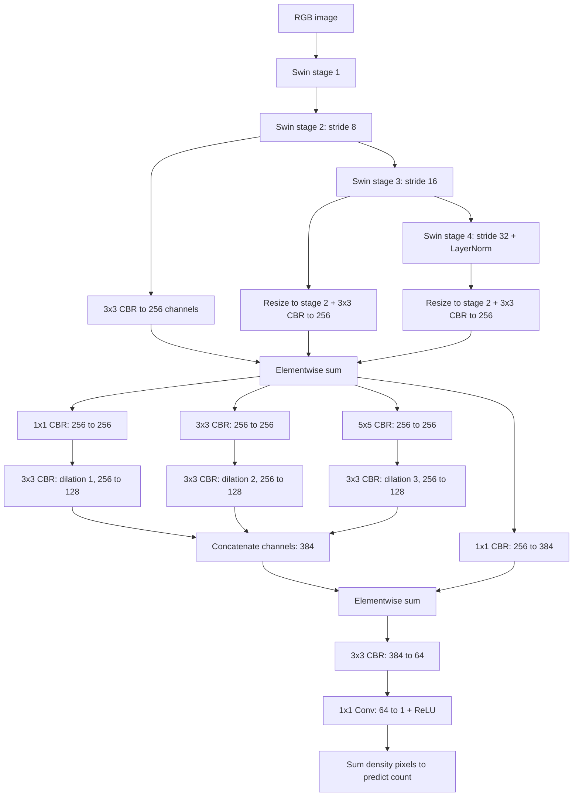

# Swin crowd counting with CCTrans Regression

The counting model uses a Swin backbone followed by the multiscale `Regression`
head adapted from [CCTrans](https://github.com/Yulu0520/CCTrans-Crowd-Counting/blob/71210285a36eb76cb22b3789dd10ee04235a17fa/Networks/ALTGVT.py).
The MAN encoder, old feature projection/head and cosine consistency objective
are removed from the active training and inference path. Historical VGG/MAN
modules remain in the repository for reference.

## Architecture



CBR means Conv + BatchNorm + ReLU. New training defaults to
`--mdc-mode preconv`: each MDC branch has a 1x1, 3x3 or 5x5 CBR (256 to 256)
before its existing 3x3 dilated CBR (256 to 128, dilation 1/2/3). Padding 0/1/2
preserves spatial size in the pre-convolutions. This adds 2,296,064 trainable
parameters compared with `--mdc-mode legacy`, the original reproduction head.
The shortcut, 384-channel concatenation, density predictor and stride are unchanged.
This follows the paper's branch layout; the Swin backbone, later predictor and
DM-Count loss remain project choices rather than an exact paper reproduction.

Use `--mdc-mode legacy` to train/resume the earlier architecture. Inference
(`test.py` and visualization) identifies either mode from checkpoint keys, even
for raw `.pth` files; no additional inference flag is needed. Complete weight
loads require matching MDC modes. To try preconv, train a new baseline, then
DoRA, DoRA1 and optional mix fine-tuning. Existing clean backbone weights may be
reused with `--backbone-checkpoint`; there is no silent partial head loading.
The new CBRs and their BatchNorm statistics need baseline training before the
frozen-BN adapter/fine-tuning stages.

Upsampling is bilinear with
`align_corners=True`, as in CCTrans, but uses the actual stage-2 spatial size
rather than fixed scale factors. Stage 2/3 have no extra output LayerNorm;
stage 4 retains the existing backbone LayerNorm.

| Backbone | Blocks per stage | Heads per stage | Stage 2/3/4 channels | Window |
| --- | --- | --- | --- | --- |
| `swin_t_trans` (CLI default) | 2/2/6/2 | 3/6/12/24 | 192/384/768 | 7 |
| `swin_l_trans` | 2/2/18/2 | 6/12/24/48 | 384/768/1536 | 12 |

A 384x384 crop produces a `[B, 1, 48, 48]` nonnegative density tensor.
`model(images)` returns this tensor directly, not the old `(density, features)`
tuple. There is no separate count head or normalized density output.
For arbitrary validation sizes, input is zero-padded on the bottom/right to a
multiple of 8; the output is `[B, 1, ceil(H/8), ceil(W/8)]`. All output cells
participate in the predicted count. Training crops must be divisible by 8.

## Loss: DM-Count (CCTrans)

All stages use the same objective form as the reference CCTrans repo:

```text
total = count_loss_weight * count_L1 + wot * OT + wtv * TV
```

| Setting | Default |
| --- | ---: |
| `--count-loss-weight` | 1.0 |
| `--wot` | 0.01 |
| `--wtv` | 0.01 |
| `--reg` (Sinkhorn entropy regularization) | 10.0 |
| `--num-of-iter-in-ot` | 100 |
| `--norm-cood` | 0 (input-pixel coordinates; 1 enables [-1, 1]) |

Bayesian/posterior supervision, cosine consistency and fractional crop targets
are no longer used by the active trainer. `--sigma`, `--background-ratio`,
`--use-background` have been removed. Count L1 defaults to weight **1**.
Use `--count-loss-weight 0.5`, for example, to halve its contribution while
keeping OT/TV weights unchanged. The value must be finite and nonnegative;
zero disables Count L1's contribution. It applies to baseline, DoRA, DoRA1
and fine-tuning; a sequential run shares this setting across stages.

```bash
python train.py --stage baseline --count-loss-weight 0.5
```

TensorBoard and training logs record both raw `count_loss` and
`weighted_count_loss`; raw count MAE remains unweighted. Resume requires the
same count weight, stored as `loss_config.count_weight` in `.tar` checkpoints.
Existing DM-Count checkpoints with count weight 1 remain compatible with the
default. `test.py` and validation MAE/RMSE/checkpoint ranking are unchanged.

The existing jpg/npy datasets still work. Only the first two annotation columns
(x, y) are used; a third nearest-neighbor-distance column is ignored. Training
keeps the existing grayscale, scale, crop and horizontal-flip augmentation,
but retains only head centers inside each crop. Every retained point counts as
one person. Empty point arrays are normalized to shape (0, 2).

A discrete map scatters one unit per retained point (duplicates accumulate),
then sums each 8x8 block to match the stride-8 prediction. No Gaussian smoothing
or fractional boundary weights are used. Its sum equals the number of retained
points. Crops use half-open bounds `0 <= x < width`, `0 <= y < height`; rounded
coordinates are clipped to the final pixel. Flip uses pixel-center coordinates
and the map is generated after augmentation. These explicit boundary rules
avoid out-of-crop points and point/map inconsistencies in the reference code.

Training computes `density / (density.sum() + 1e-6)` separately for each image.
This normalized density is only used for distribution supervision; the model
continues to return the **raw** density tensor for inference/counting.
OT matches the predicted distribution to the uniform distribution over head
points using the reference Sinkhorn solver and detached dual-potential gradient.
TV is the pixelwise L1 difference between normalized prediction and normalized
discrete target, multiplied by the crop count; it is not spatial-gradient TV.
Empty crops skip OT and have zero TV contribution, so count L1 penalizes false
positives. All loss arithmetic uses FP32.

For parity with CCTrans, **count and TV average over the batch, whereas OT sums
over images**. Changing batch size changes OT's relative gradient contribution.
The OT loss scalar is a gradient surrogate and may be near zero or negative;
its scalar value is not the Wasserstein distance. TensorBoard records raw
count/OT/TV, weighted OT/TV, total loss, Wasserstein distance, OT dual objective,
MAE and RMSE. Nonfinite terms stop training with an error instead of silently
updating corrupted weights. OT increases training time/memory, not inference cost.

The model, Regression initialization, optimizer (Adam), learning rates,
validation and `2 * RMSE + MAE` checkpoint selection remain unchanged. CCTrans's
AdamW, patch validation and MAE-only selection are not part of this loss change.

## Training

Install dependencies with `pip install -r requirements.txt`. Training uses a single GPU by default; `--device cpu` is also available for smoke tests. Start by training a new baseline:

```bash
python train.py --stage baseline

# Or run baseline -> DoRA -> DoRA1 in sequence.
python train.py --stage all
```

The CLI defaults to `--stage all`: a bare `python train.py` runs all three stages.
Use `--stage baseline` to compare the new loss before training adapters.
Defaults otherwise remain unchanged: Swin-T, 256x256 crops, batch size 4,
10 epochs per stage, validation every 5 epochs starting at index 0, baseline
LR 5e-6, adapter LR 2e-4, and weight decay 1e-5.

| Stage | Default training split | Default validation split | Trainable parameters |
| --- | --- | --- | --- |
| baseline | `SHA/day/train` | `SHA/day/val` | Swin + complete Regression head |
| dora | `SHA/night/train` | `SHA/night/val` | DoRA Q/V direction and magnitude |
| dora1 | `SHA/night/train` | `SHA/day/val` | DoRA1 Q/V direction and magnitude |
| finetune | `SHA/mix/train` | `SHA/mix/val` | Complete shared Regression head only |

The CLI paths point under `/home/mmslab-1080/Desktop/img2img-turbo/`;
override them with `--data-dir`, `--dora-train-dir`, `--dora-val-dir`,
`--dora1-train-dir`, and `--dora1-val-dir`. Each split uses jpg images and
matching npy point annotations. The DoRA1 training split remains night even
though the inference day route selects DoRA1.

```bash
python train.py --stage dora --baseline-checkpoint /path/to/NEW/baseline/run_directory
python train.py --stage dora1 --dora-checkpoint /path/to/NEW/dora/run_directory
```

Both adapters read the same frozen baseline weights and are mutually exclusive.
They affect Q/V in all 12 Swin-T or 24 Swin-L attention blocks; K and biases
remain frozen. Default rank/alpha are 4/4 for both branches. In adapter stages,
the entire model stays in eval mode while only the active adapter receives
gradients. The new head, including BatchNorm running statistics, stays frozen.

Swin-T uses torchvision ImageNet-1K pretraining. Swin-L reads the official
ImageNet-22K `pre_models/swin_large_patch4_window12_384_22k.pth`, or
`--pretrained-path`. `--no-pretrained-backbone` disables ImageNet initialization.

### Mix head fine-tuning (fourth stage)

After training baseline, DoRA and DoRA1, fine-tune the complete shared Regression
head on mix images. Swin (including LayerNorm), both adapters and the trained
router remain frozen. Regression BatchNorm running means/variances remain
frozen; its affine weights/biases are trainable. The loss stays
`count_L1 + 0.01 * OT + 0.01 * TV` unless you explicitly override its weights.

For each original RGB image, the frozen router first selects day (DoRA1) or
night (DoRA). Its separate 224x224 input is made before counting augmentation.
Only the selected backbone branch runs for that image. Within a batch, images
are grouped by branch to extract frozen stage-2/3/4 features, then restored to
the original order for one shared Regression forward and the usual batch loss.
Filename routing is optional: `night_` selects DoRA, other names select DoRA1.

```bash
# Start from a completed DoRA1 run (contains both trained adapters).
python train.py --stage finetune \
  --finetune-checkpoint /path/to/dora1/run_directory \
  --router-checkpoint /path/to/router/best_model.pth \
  --finetune-train-dir /path/to/SHA/mix/train \
  --finetune-val-dir /path/to/SHA/mix/val \
  --finetune-lr 1e-7 --weight-decay 1e-5

# Run all four stages; the best-ranked weights feed the next stage.
python train.py --stage all --finetune-after-all \
  --router-checkpoint /path/to/router/best_model.pth

# Alternative: filename decisions, with no classifier checkpoint required.
python train.py --stage finetune \
  --finetune-checkpoint /path/to/dora1/run_directory \
  --finetune-router-mode filename
```

Defaults: Adam, 50 epochs, **constant LR `1e-7`**, and the same
`--weight-decay 1e-5` used by baseline/DoRA/DoRA1. Set `--finetune-lr` to change
the fixed LR; weight decay regularizes trainable parameters and does not decay
the learning rate. There is no warmup/cosine scheduler. The old
`--finetune-start-lr`, `--finetune-min-lr`, and `--finetune-warmup-epochs` flags
have been removed. To fine-tune an old DoRA1 model without changing its head,
add `--mdc-mode legacy` to the training command.
Validation runs before any updates (epoch 0) and after every epoch, reporting
mix overall/day/night MAE and RMSE, route counts, and router accuracy against
filename labels. These labels are diagnostic; classifier decisions use pixels.
The untouched epoch-0 weights are eligible for the top five.

`--stage all` without `--finetune-after-all` still runs the original three stages.
To resume fine-tuning, use `--stage finetune --resume /path/to/N_ckpt.tar`
with the same MDC mode, data, routing mode/checkpoint, adapter settings, loss
settings, fixed LR and weight decay. The router file content is checked by
SHA256. Resume restores optimizer, epoch and top-five rankings; the initial
validation is not repeated. Old warmup/cosine fine-tune `.tar` files can still be
evaluated but cannot resume into the constant-LR training mode. Start a fresh
fine-tune from the matching DoRA1 model when changing this training policy.

### Top-five checkpoint policy

Every stage retains up to five validation checkpoints ranked by
`score = MAE + 2 * RMSE` (smaller is better), including candidates that are not
new records. Filenames are `MAE70.14_epoch120.pth`; displayed MAE is rounded,
but `rankings.json` stores full-precision MAE/RMSE/score. Ties prefer smaller
MAE, RMSE, then earlier epoch. These `.pth` files contain complete model weights.
New runs use ranked filenames rather than a `best_model.pth` alias.

Pass a run directory wherever a counting checkpoint is accepted to select its
rank-1 entry. Sequential training does the same automatically. With no explicit
checkpoint, evaluation resolves the newest run directory under
`model/<model-name>/<stage>/` and reads its ranking; it does not rank weight-file
modification times. Explicit legacy `best_model.pth` paths still work.

Epoch `N_ckpt.tar` files are separate resume snapshots. `--max-model-num`
(default 1) controls only their retention, independently of the five weights;
`--save-all` is retained as a deprecated no-op. Resume copies/hardlinks retained
ranked weights into the new run directory, so keep the source run alongside its
latest `.tar`. Missing ranked files produce an error instead of silently losing
candidates. Legacy resume files can restore their single recorded best weight.

### Checkpoints and migration

Old MAN checkpoints cannot be used as complete baselines, adapter models or
resume checkpoints. Train the new Regression head as part of a new baseline,
then retrain both adapters. To explicitly reuse only an old clean baseline's
Swin backbone (the head is freshly initialized):

```bash
python train.py --stage baseline --backbone-checkpoint /path/to/OLD/baseline/best_model.pth
```

This option requires a matching Swin variant, a clean baseline without adapters,
and cannot be combined with resume. It also works with a new clean baseline.
There is no implicit partial loading of an incompatible head.

Epoch `.tar` checkpoints record `mdc_mode` and
`architecture=swin_cctrans_regression_v2_mdc_preconv` (or
`swin_cctrans_regression_v1` for legacy), `output_stride=8`, model name, stage,
optimizer, crop size, `loss_type=dm_count_v1`,
the complete OT/TV settings and crop-target policy, and adapter settings. Best `.pth` files remain raw state dicts; head keys and
strict weight shapes verify compatibility. Supply matching adapter rank/alpha
when loading `.pth`. Resume a new-architecture stage with `--resume file.tar`.
Resume requires matching loss type, OT/TV settings, crop size and batch size; it restores
optimizer, epoch and best metrics, plus the saved top-five candidates when available. Best-model selection remains `2 * RMSE + MAE`. Output paths remain `model/<model-name>/<stage>/<run>/`.

### Switching from Bayesian training to DM-Count

Existing **Swin + CCTrans Regression** weights remain architecture-compatible.
To reuse a full baseline (backbone and head) from the previous objective, start
a fresh experiment with a new optimizer, epoch counter and best metrics:

```bash
python train.py --stage baseline --model-name swin_t_trans --mdc-mode legacy \
  --init-checkpoint /path/to/previous/baseline/best_model.pth \
  --save-dir model_dm_count --pretrain-epochs 100 --pretrain-val-epoch 1
```

`--init-checkpoint` accepts matching-stage `.pth` or `.tar` models, including
previous Bayesian Regression checkpoints. It cannot be combined with `--resume`
or `--backbone-checkpoint`. For DoRA/DoRA1 initialization it requires the complete
dual-adapter state and matching rank/alpha. In a sequential pipeline it applies
only to the initial baseline; later stages use the newly trained parent.
Old MAN full-model checkpoints remain incompatible: use the explicit
`--backbone-checkpoint` option to reuse only their clean Swin weights.

```bash
# Resume the same DM-Count experiment, preserving its settings.
python train.py --stage baseline --resume /path/to/dm_count/10_ckpt.tar \
  --wot 0.01 --wtv 0.01 --reg 10 --num-of-iter-in-ot 100 --norm-cood 0
```

Previous Bayesian `.tar` files cannot be resumed under a different objective;
use `--init-checkpoint` instead. Raw `.pth` files are weights only, so they also
use `--init-checkpoint`, not `--resume`. Model architecture metadata and strict
weight-shape checks continue to protect against incompatible heads.

## Evaluation and routing

The existing MobileNetV3-Small router and its checkpoints are unchanged.
Router input is a separate 224x224 copy; the counting model receives the original
image. Day selects DoRA1, night selects DoRA. Filename routing uses the `night_`
prefix; classifier routing uses pixels only.

```bash
python train_router.py --data-root /path/to/SHA/mix
python test.py --router-mode classifier --domains mix --split val \
  --dora1-checkpoint /path/to/NEW/dora1/best_model.pth \
  --router-checkpoint /path/to/router/best_model.pth

python test.py --router-mode filename --domains mix \
  --dora1-checkpoint /path/to/NEW/dora1/best_model.pth
```

Fine-tuned checkpoints accept the same classifier, filename and fixed routing.
To compare before/after head fine-tuning with the same router:

```bash
python test.py --router-mode classifier --domains mix --split val \
  --data-root /path/to/SHA \
  --dora1-checkpoint /path/to/dora1/run_directory \
  --finetune-checkpoint /path/to/finetune/run_directory \
  --router-checkpoint /path/to/router/best_model.pth

# Evaluate only the best fine-tuned weights using filenames.
python test.py --router-mode filename --domains mix \
  --finetune-checkpoint /path/to/finetune/run_directory

# Fixed route, without requiring baseline/DoRA checkpoints.
python test.py --router-mode fixed --dual-route dora1 --domains mix \
  --finetune-checkpoint /path/to/finetune/run_directory
```

Use `--checkpoint-stage finetune` for automatic discovery of the newest
fine-tune run when omitting an explicit path. `.pth`, `.tar` and ranked run
directories are accepted. Pass matching `--model-name` and adapter rank/alpha.
The router is loaded separately and remains frozen; use the same router as in
training. A raw weight file does not include its training configuration.

`test_results.csv` includes `subset=overall/day/night` for mix, with separate
model labels for before/after comparisons. `routing_results.csv` records each
image's selected branch, confidence, expected/detected domain, ground-truth
count, predicted count and error, plus its model label. Day/night subsets use
filename labels, not the router's prediction. For a fixed-route comparison of
baseline/DoRA/DoRA1, supply their respective checkpoint flags as before.
Images at least 3584 pixels on either axis use non-overlapping patches with
summed counts; routing is chosen once per original image, before patching.

## Visualization

Both tools accept `--model-name`, adapter rank/alpha, `--dual-route`, `.pth`/`.tar`
checkpoints or ranked run directories (including fine-tuned models), and `--device cpu` (or a GPU index).

```bash
python save_density_and_var.py --data-dir /path/to/val \
  --model-path /path/to/NEW/best_model.pth
python save_attention.py --data-dir /path/to/image.jpg \
  --model-path /path/to/NEW/best_model.pth
```

`save_density_and_var.py` saves native-stride density arrays and color previews.
`save_attention.py` now saves channel-mean activation-magnitude overlays for the
fused 256-channel features and the 384-channel regression features. These are
feature visualizations, not MAN attention maps.

## Verification

```bash
python -m unittest discover -s tests -v
```

The tests cover reference CCTrans loss/gradient parity (including OT batch
reduction), discrete-map mass conservation, augmentations, duplicate/edge/empty
points, zero/tiny predictions, both backbones, all selected stages' gradients,
real baseline/adapter training steps, frozen BatchNorm, weight-only migration,
resume setting checks, checkpoint compatibility and existing routing behavior.
Fine-tuning tests also cover grouped branch order, frozen backbone/BN state,
fixed LR/weight decay restoration, real CPU training/resume, epoch-0 retention and top-five
selection using full-precision scores.

## Citation
If you use this code for your research, please cite our paper:

```
@inproceedings{lin2022boosting,
  title={Boosting Crowd Counting via Multifaceted Attention},
  author={Lin, Hui and Ma, Zhiheng and Ji, Rongrong and Wang, Yaowei and Hong, Xiaopeng},
  booktitle={CVPR},
  year={2022}
}
```
