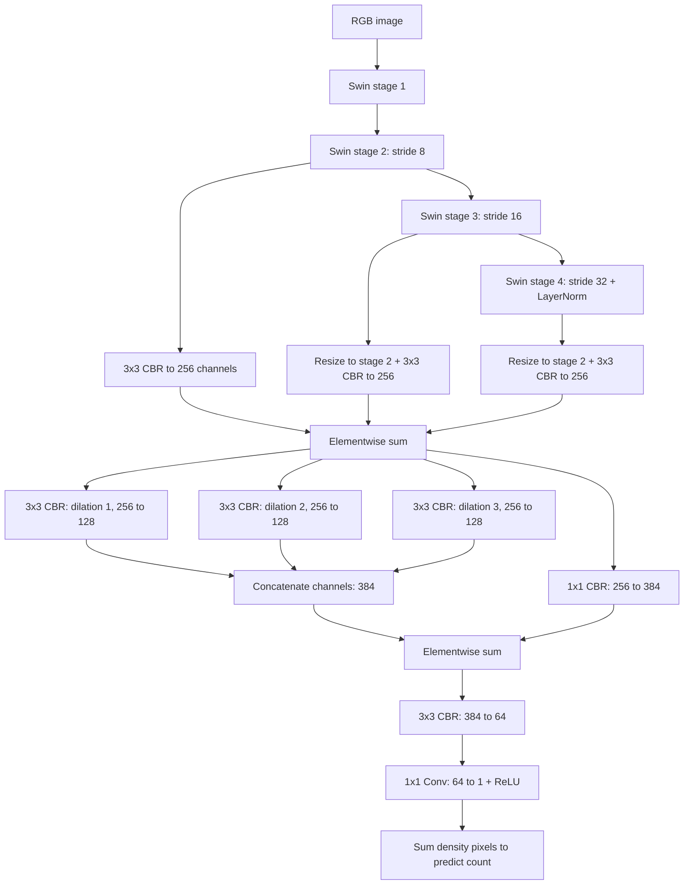

# Swin crowd counting with CCTrans Regression

The counting model uses a Swin backbone followed by the multiscale `Regression`
head adapted from [CCTrans](https://github.com/Yulu0520/CCTrans-Crowd-Counting/blob/71210285a36eb76cb22b3789dd10ee04235a17fa/Networks/ALTGVT.py).
The MAN encoder, old feature projection/head and cosine consistency objective
are removed from the active training and inference path. Historical VGG/MAN
modules remain in the repository for reference.

## Architecture



CBR means Conv + BatchNorm + ReLU. Upsampling is bilinear with
`align_corners=True`, as in CCTrans, but uses the actual stage-2 spatial size
rather than fixed scale factors. Stage 2/3 have no extra output LayerNorm;
stage 4 retains the existing backbone LayerNorm.

| Backbone | Blocks per stage | Heads per stage | Stage 2/3/4 channels | Window |
| --- | --- | --- | --- | --- |
| `swin_t_trans` (CLI default) | 2/2/6/2 | 3/6/12/24 | 192/384/768 | 7 |
| `swin_l_trans` | 2/2/18/2 | 6/12/24/48 | 384/768/1536 | 12 |

A 384x384 crop produces a `[B, 1, 48, 48]` nonnegative density tensor.
`model(images)` returns this tensor directly, not the old `(density, features)`
tuple. There is no separate count head or normalized density output.
For arbitrary validation sizes, input is zero-padded on the bottom/right to a
multiple of 8; the output is `[B, 1, ceil(H/8), ceil(W/8)]`. All output cells
participate in the predicted count. Training crops must be divisible by 8.

## Loss

```text
total = Bayesian + count_loss_weight * count_L1
```

`--count-loss-weight` defaults to 0.1. Bayesian supervision (including background
and its existing foreground-error selection), sigma and background ratio are
unchanged. Count L1 compares each crop's density sum with `targets.sum()`,
including fractional people at crop boundaries, then averages over the batch.
Empty crops have zero target count. No cosine, OT or TV loss is used.
`--downsample-ratio` is fixed to 8 in training/testing so the Bayesian probability
grid matches the new head. TensorBoard logs total, Bayesian, raw/weighted count
loss, MAE and RMSE; consistency scalars are no longer produced.

## Training

Install dependencies with `pip install -r requirements.txt`. Training retains
the single-GPU requirement. Start by training a new baseline:

```bash
python train.py --stage baseline

# Or run baseline -> DoRA -> DoRA1 in sequence.
python train.py --stage all
```

The CLI still defaults to `--stage dora1`, which requires `--dora-checkpoint`
or `--resume`; a bare `python train.py` does not start a new baseline.
Defaults otherwise remain unchanged: Swin-T, 384x384 crops, batch size 4,
10 epochs per stage, validation every 5 epochs starting at index 0, baseline
LR 5e-6, adapter LR 2e-4, and weight decay 1e-5.

| Stage | Default training split | Default validation split | Trainable parameters |
| --- | --- | --- | --- |
| baseline | `SHA/day/train` | `SHA/day/val` | Swin + complete Regression head |
| dora | `SHA/night/train` | `SHA/night/val` | DoRA Q/V direction and magnitude |
| dora1 | `SHA/night/train` | `SHA/day/val` | DoRA1 Q/V direction and magnitude |

The CLI paths point under `/home/mmslab-1080/Desktop/img2img-turbo/`;
override them with `--data-dir`, `--dora-train-dir`, `--dora-val-dir`,
`--dora1-train-dir`, and `--dora1-val-dir`. Each split uses jpg images and
matching npy point annotations. The DoRA1 training split remains night even
though the inference day route selects DoRA1.

```bash
python train.py --stage dora --baseline-checkpoint /path/to/NEW/baseline/best_model.pth
python train.py --stage dora1 --dora-checkpoint /path/to/NEW/dora/best_model.pth
```

Both adapters read the same frozen baseline weights and are mutually exclusive.
They affect Q/V in all 12 Swin-T or 24 Swin-L attention blocks; K and biases
remain frozen. Default rank/alpha are 4/4 for both branches. In adapter stages,
the entire model stays in eval mode while only the active adapter receives
gradients. The new head, including BatchNorm running statistics, stays frozen.

Swin-T uses torchvision ImageNet-1K pretraining. Swin-L reads the official
ImageNet-22K `pre_models/swin_large_patch4_window12_384_22k.pth`, or
`--pretrained-path`. `--no-pretrained-backbone` disables ImageNet initialization.

### Checkpoints and migration

Old MAN checkpoints cannot be used as complete baselines, adapter models or
resume checkpoints. Train the new Regression head as part of a new baseline,
then retrain both adapters. To explicitly reuse only an old clean baseline's
Swin backbone (the head is freshly initialized):

```bash
python train.py --stage baseline --backbone-checkpoint /path/to/OLD/baseline/best_model.pth
```

This option requires a matching Swin variant, a clean baseline without adapters,
and cannot be combined with resume. It also works with a new clean baseline.
There is no implicit partial loading of an incompatible head.

Epoch `.tar` checkpoints record `architecture=swin_cctrans_regression_v1`,
`output_stride=8`, model name, stage, optimizer, crop size, count-loss weight,
and adapter settings. Best `.pth` files remain raw state dicts; head keys and
strict weight shapes verify compatibility. Supply matching adapter rank/alpha
when loading `.pth`. Resume a new-architecture stage with `--resume file.tar`.
CLI count-loss weight controls the objective on resume. Best-model selection
remains `2 * RMSE + MAE`. Output paths remain `model/<model-name>/<stage>/<run>/`.

## Evaluation and routing

The existing MobileNetV3-Small router and its checkpoints are unchanged.
Router input is a separate 224x224 copy; the counting model receives the original
image. Day selects DoRA1, night selects DoRA. Filename routing uses the `night_`
prefix; classifier routing uses pixels only.

```bash
python train_router.py --data-root /path/to/SHA/mix
python test.py --router-mode classifier --domains mix --split val \
  --dora1-checkpoint /path/to/NEW/dora1/best_model.pth \
  --router-checkpoint /path/to/router/best_model.pth

python test.py --router-mode filename --domains mix \
  --dora1-checkpoint /path/to/NEW/dora1/best_model.pth
```

For a fixed-route comparison, set `--router-mode fixed` and supply new baseline,
DoRA and optional DoRA1 checkpoints. MAE/RMSE and per-image routing CSV formats
are unchanged. Images at least 3584 pixels on either axis are split as before;
counts from the non-overlapping patches are summed. The old hardcoded default
counting-checkpoint path must be overridden with your new checkpoint.

## Visualization

Both tools accept `--model-name`, adapter rank/alpha, `--dual-route`, `.pth`/`.tar`
checkpoints, and `--device cpu` (or a GPU index).

```bash
python save_density_and_var.py --data-dir /path/to/val \
  --model-path /path/to/NEW/best_model.pth
python save_attention.py --data-dir /path/to/image.jpg \
  --model-path /path/to/NEW/best_model.pth
```

`save_density_and_var.py` saves native-stride density arrays and color previews.
`save_attention.py` now saves channel-mean activation-magnitude overlays for the
fused 256-channel features and the 384-channel regression features. These are
feature visualizations, not MAN attention maps.

## Verification

```bash
python -m unittest discover -s tests -v
```

The tests cover both backbones, arbitrary image sizes, Bayesian/count-loss
gradients through every selected stage, frozen adapter-stage BatchNorm, route
selection, checkpoint compatibility and the existing router/DoRA behavior.

## Citation
If you use this code for your research, please cite our paper:

```
@inproceedings{lin2022boosting,
  title={Boosting Crowd Counting via Multifaceted Attention},
  author={Lin, Hui and Ma, Zhiheng and Ji, Rongrong and Wang, Yaowei and Hong, Xiaopeng},
  booktitle={CVPR},
  year={2022}
}
```
